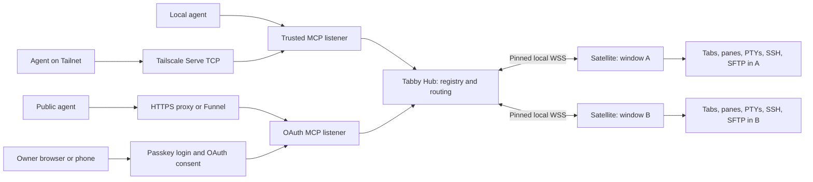

# Tabby Hub and satellite architecture

Status: implementation architecture, 2026-10-02. The Hub and satellite are implemented.
See [installation](installation.md) for operating instructions and native release acceptance limits.

The shipped baseline exposes tools over Streamable HTTP and the stdio bridge.
Optional MCP resources/subscriptions, durable operation audit records and directory
restrictions on file grants remain extensions described below.

The Hub is one independently supervised Node process for the signed-in OS user. It exposes a single logical MCP server named **Tabby Hub**. Every Tabby window loads one satellite, which connects outward to the Hub and controls only that window. Agents discover and address every connected window through the Hub.

Supporting documents: [complete upstream capability inventory](tabby-mcp-capabilities.md) and [authentication research](authentication.md).

## Evidence and scope

The upstream reference is [GentlemanHu/Tabby-MCP at commit 86a52fdfadb724959929f052c1fc89a45c9f1b0f](https://github.com/GentlemanHu/Tabby-MCP/tree/86a52fdfadb724959929f052c1fc89a45c9f1b0f), package version 1.7.1. Its category initialization registers **36 tools: 15 tab/profile, 9 terminal, 12 SFTP**. SFTP registration depends on the SSH plugin. The inventory records every tool, its inputs, behavior, and limitations.

The default upstream catalog is 35 tools when SSH is installed: environment detection must be enabled to expose the 36th. Treat 36 as the complete implemented catalog, not the unconditional result of `tools/list`.

The existing Angular module starts a window-owned HTTP server after application readiness and stops it on unload. Each server reads its own injected `AppService.tabs`. The configured loopback port has one owner; the current source includes a shutdown/handover mechanism for another instance. This can replace the serving window, but cannot combine their tabs. That is the architectural cause of the reported behavior. [Module lifecycle](https://github.com/GentlemanHu/Tabby-MCP/blob/86a52fdfadb724959929f052c1fc89a45c9f1b0f/src/index.ts#L62), [port ownership](https://github.com/GentlemanHu/Tabby-MCP/blob/86a52fdfadb724959929f052c1fc89a45c9f1b0f/src/services/mcpService.ts#L632), [terminal enumeration](https://github.com/GentlemanHu/Tabby-MCP/blob/86a52fdfadb724959929f052c1fc89a45c9f1b0f/src/tools/terminal.ts#L1272).

The Hub continues answering discovery and health requests when Tabby is closed, returning zero live windows. Shells, panes, SSH connections, and terminal buffers remain owned by Tabby and require a connected window. Keeping shells alive after closing Tabby would require a separate terminal/session host and is outside this design. An unavailable target produces an explicit error; it never silently selects another window.

## Process and network layout



Three listeners give the three trust boundaries distinct entry points. Example ports are configurable and must be checked for conflicts during installation.

| Listener | Binding | Purpose | Authorization |
| --- | --- | --- | --- |
| Trusted agents | `127.0.0.1:3001` | HTTP MCP at `/mcp`; local and Tailnet agents | No application token, as requested |
| Satellites | `127.0.0.1:3002` | WSS at `/satellite`; local control/diagnostics with a separate credential | Pinned TLS plus installation credential |
| Public access | `127.0.0.1:3003` behind HTTPS | MCP, OAuth discovery, owner login/consent | Bearer token for MCP; owner session for management |

Public access is opt-in. A conventional HTTPS proxy for a public hostname/IP and a Tailscale Funnel mount both target port 3003. That listener requires authentication even when its socket peer is loopback. Agent listeners never expose satellite registration or unauthenticated owner administration.

For portable direct Tailnet access, let the installed Tailscale daemon forward a Tailnet-only TCP port to the trusted agent listener:

```sh
tailscale serve --bg --tcp=3001 tcp://127.0.0.1:3001
```

Agents then use `http://<host-tailnet-IP>:3001/mcp`. They reach the port directly over their encrypted Tailnet connection; Tailscale handles network authentication before forwarding. Apply a grant for the intended owner devices/agent tags. This avoids custom platform-dependent Tailscale socket bindings or treating an IP range as proof of identity. [Official Serve CLI](https://tailscale.com/docs/reference/tailscale-cli/serve), [grants](https://tailscale.com/docs/reference/syntax/grants).

Funnel must target only the public listener. Installation checks preserve existing Serve/Funnel mappings and diagnose conflicting exposure. Never enable a blanket `trust proxy`, infer trust from `X-Forwarded-For`, or exempt public requests because a proxy connected from `127.0.0.1`. If Tailscale is absent, local operation still works and the Tailnet route is unavailable.

## Responsibilities

| Component | Owns |
| --- | --- |
| Hub | MCP transport, authentication/authorization, live window registry, target resolution, request correlation, subscription fanout, agent grant management, service/installation CLI |
| Satellite | Window identity and readiness, tab/profile/pane operations, shell input and output, command tracking, SSH authentication, SFTP sessions/transfers, confirmation dialogs, window-local configuration |
| Shared protocol | Versioned request/event schemas, tool catalog, identity types, capability flags, error codes |
| OS supervisor | Starting/restarting the Hub independently of any Tabby window |

Adapt upstream handlers into the satellite, retaining their MIT notice. Remove their Express/MCP server, port-handover code, and agent-session management. Use Tabby's injected services and its existing PTY/SSH/SFTP implementations. The Hub routes operations; it does not open replacement SSH connections or execute a terminal command in the daemon's shell.

Satellite settings retain upstream tool toggles, pair-programming confirmation, automatic focus/background execution, and capture preferences. Hub grants and satellite settings both apply: a Hub permission cannot enable a tool disabled by its satellite. Settings/history that describe agent connections move to the Hub; confirmations and terminal focus remain in the target window.

Preserve working upstream settings rather than copying inert controls. The inspected session-metadata switches do not govern enumeration, the SFTP timeout is unused, and split ratio is ignored. The replacement should enforce metadata preferences, bounded operation/transfer timeouts, and supported split sizing, or report a capability as unsupported instead of accepting and ignoring its input.

## Identity and window locking

Tabby provides a native `BootstrapData.windowID` and `userPluginsPath`. Use the native window ID as diagnostic metadata rather than assuming it is globally unique across Tabby processes/restarts. [Tabby bootstrap API](https://docs.tabby.sh/interfaces/BootstrapData.html).

The satellite creates a random `windowId` for its window incarnation and retains it across socket reconnects. Registration also includes native window ID, renderer PID, satellite version, Tabby version, platform, label, and advertised capabilities. The Hub binds the authenticated socket to that `windowId` once. A reconnect credential identifies the existing incarnation; a new renderer/reloaded plugin starts a new incarnation and invalidates old targets.

Each window publishes stable local `tabId`, `sessionId` (one per terminal pane), `profileId`, and `transferId`. The Hub returns opaque global IDs with an ownership map to `(windowId, localId)`. IDs remain stable while their underlying object survives; tab reordering changes only display indices. The connection epoch changes on reconnect, so replies from a replaced connection cannot satisfy new requests.

Required invariants:

1. One live satellite connection per window incarnation. Reject competing registrations; replace a known disconnected socket only after authenticated resume.
2. Satellite responses/events belong to the socket's bound window. Reject claimed IDs for another window or operations outside the registered tool catalog.
3. Hub requests include the intended window and connection epoch; the satellite rejects a mismatch before touching Tabby.
4. A supplied global tab/session/transfer ID must belong to the supplied window. Failure is an error, never a fallback to an active tab or a title match.
5. Existing tabs transferred between windows must be re-announced by their new owner. During transfer, stale ownership fails rather than dispatching twice; preserve an object ID only when Tabby actually preserves the object identity.

This is routing isolation between cooperating plugins. It is not OS attestation that an Electron window is authentic. A process with the user's satellite credential is trusted as that user; loopback alone cannot prove an OS account.

## Satellite connection lifecycle

The installer creates a private loopback TLS certificate/key and a separate high-entropy registration credential. Satellites trust the installed certificate/CA and verify the expected certificate identity or SPKI pin before transmitting their credential in a WSS upgrade header. Do not disable TLS validation globally or put secrets in a query string. A process occupying port 3002 cannot acquire the credential by pretending to be the Hub. Certificate/key changes are coordinated through the private state directory.

After Tabby's app/config readiness:

1. Connect to the configured loopback WSS endpoint, authenticate, and negotiate protocol major/minor versions.
2. Send registration followed by a complete window/tab/pane/profile/transfer snapshot. Become routable only after validation.
3. Send ordered topology changes, output chunks for subscribed sessions, command/transfer progress, and heartbeats. The Hub may request a new snapshot after a detected gap.
4. Receive operations and cancellation messages. Execute through the same window-local handlers and return correlated results.
5. On unload, send a best-effort departure and close. Socket closure or missed heartbeats marks the window offline even if unload notification never arrives.

Initial timing defaults: heartbeat every 10 seconds, offline after 30 seconds without a heartbeat, reconnect with jittered exponential delay capped at 30 seconds. Reconnect after host sleep follows the same snapshot procedure. Start order does not matter: a satellite may start before the Hub and retry without disrupting the terminal.

Use one WebSocket per satellite and a small versioned JSON envelope, without a message broker:

```ts
type SatelliteMessage =
  | { type: 'request'; id: string; windowId: string; epoch: string;
      operation: string; params: unknown; deadline: number }
  | { type: 'response'; id: string; windowId: string; epoch: string;
      result?: unknown; error?: { code: string; message: string } }
  | { type: 'event'; windowId: string; epoch: string; sequence: number;
      event: string; data: unknown };
```

Registration, snapshots, heartbeats, and cancellation have corresponding validated envelopes. Deadlines are created by the Hub; satellites bound them against local monotonic time rather than relying on perfectly synchronized wall clocks. Agent input is validated at the Hub and operation input again at the satellite. Bound frame sizes, outstanding requests, and unauthenticated connections.

Do not replay a mutating request automatically after a disconnect. If the command/tab-open/file-write may already have happened, return `OUTCOME_UNKNOWN` with its request ID and require inspection. Retain a bounded recent request-result cache in the satellite so the Hub can query a still-live incarnation for an uncertain result. This does not promise exactly-once execution after a satellite crash.

## MCP surface and targeting

Retain the **36 original tool names** with additive target/result fields. The baseline adds just two tools:

| New tool | Purpose |
| --- | --- |
| `list_windows` | Connected/offline window metadata, capabilities, epoch, and topology revision |
| `read_terminal_output` | Incremental bounded output using a cursor; optional bounded wait for the next output |

Together these give 38 baseline tools. There is no separate `list_panes`: `get_session_list` lists every terminal pane with its parent tab and window. `open_profile` and `quick_connect` open new tabs in a selected window; `split_tab` opens panes. SFTP tools operate through the selected pane's existing SSH connection.

Add `windowId` to every window-local operation. Discovery tools (`list_tabs`, `get_session_list`, `list_profiles`, `get_command_status`, `sftp_list_transfers`) can aggregate all authorized live windows when it is absent; results always include their window. Per-window profiles may have equivalent definitions, but opening one still requires a chosen window.

For mutation, resolve a window from an exact global tab/session/transfer ID or require `windowId`. With exactly one authorized live window, omission may resolve to it for old-client compatibility. With several windows and no unique target, return `AMBIGUOUS_TARGET` and the permitted choices. Never pick the first window or last focused window globally. `close_all_tabs` always applies to one resolved window.

Within the selected window, preserve upstream title/profile/index locators for compatibility, but return `AMBIGUOUS_TARGET` for multiple matches. Exact IDs never degrade to weaker locators. Add exact tab/session targets to originally active-tab-only operations so agents need not race through focus changes. `tabIndex` is explicitly legacy: upstream terminal indices flatten panes while tab/SFTP indices use top-level tabs; the shared adapter documents each and encourages IDs.

Tools have a stable advertised schema/catalog; satellite capability flags describe which operations are currently supported. A satellite lacking SSH can still provide all local terminal/tab operations and returns `CAPABILITY_UNAVAILABLE` for SFTP. Authorization filters what a public agent can discover, but actual execution also checks its current permissions. Adding/removing a window changes resource data, not hundreds of dynamically generated tool names.

Optional MCP resources expose window topology and terminal snapshots under `tabby://windows`, `tabby://windows/{windowId}/tabs`, and `tabby://sessions/{sessionId}/output`. They are Hub additions, not upstream features. Enforce the same grants on list/read/subscribe as on tools. No prompts are required for capability parity.

## Terminal streaming and execution

Input uses the existing `send_input` tool, routed over the full-duplex satellite socket. Output originates from the target terminal's session output observable, never from spawning a new shell in the Hub. Use one capture subscription per observed pane and fan out to readers. Preserve byte/encoding information when the host API supplies it; do not claim separate stdout/stderr from a combined PTY stream.

Each observed session has a bounded in-memory output ring in its satellite, an output epoch, and monotonically increasing sequence numbers. Limits: 1 MiB per captured session, 32 MiB total per satellite, 64 KiB per read, and at most 25 seconds for a long-poll read. Capture starts before monitored execution or when an agent first requests observation; the existing terminal buffer supplies earlier visible scrollback. Do not imply uncaptured history is available. Eviction reports a gap and the oldest available cursor. Never block the user's PTY because an agent consumes output slowly.

`read_terminal_output` returns base64 bytes, encoding, byte count, a `cursor` containing the output epoch and absolute offset, and a `gap` flag. A client can repeatedly call it while writing input with ordinary tools. Modern clients may subscribe to the output resource and retrieve changes using the SDK's supported subscription/listen stream. The current 2026-07-28 protocol and older 2025-era clients differ in transport lifecycle; use official SDK v2 compatibility, not custom SSE notification semantics. [SDK protocol support](https://ts.sdk.modelcontextprotocol.io/v2/protocol-versions), [current HTTP transport](https://modelcontextprotocol.io/specification/2026-07-28/basic/transports/streamable-http).

Keep `get_terminal_buffer` as a readable screen/scrollback snapshot. A terminal screen is not an append-only log, especially with full-screen programs; its line indices must not be used as output-stream cursors.

Waiting `exec_command` retains shell-aware completion/exit-code collection. Use collision-resistant per-command markers and a streaming parser that survives chunk boundaries. Only one monitored command may own a pane at a time; a competing execution returns `SESSION_BUSY`. The owning agent may send required interactive input or abort. Closing/reconnecting the pane cancels waits. Timeout means observation ended, not proof that the shell process stopped; Ctrl+C is a best-effort interrupt, not a guaranteed kill.

Monitored CMD commands use batch syntax (for example, `for %%i`) in a child CMD process launched by Windows PowerShell, with completion markers emitted by the original prompt. Incomplete syntax cannot consume the marker or close the pane. CMD can exit with code zero before finishing an incomplete block, so a zero exit without the command's completion probe reports `OUTCOME_UNKNOWN`; deliberate early exits such as `exit /b 0` can have the same result. Child directory/environment changes do not persist; use `send_input` when persistent shell state or interactive input is required.

Track asynchronous submissions too, but report `submitted`/`unknown` when no reliable completion observation exists. `get_command_status` describes Hub/satellite-observed commands, not a general OS process table. Preserve user confirmations and focus/background settings before writing input; a background window remains fully routable without being brought to the foreground.

Cross-platform parity needs explicit command adapters for POSIX sh/bash/zsh, fish, PowerShell (Windows PowerShell and pwsh), and CMD. Use confirmed profile/session shell information, and use raw input when detection is uncertain. Never send POSIX wrappers into a PowerShell shell or arbitrary REPL. Where completion cannot be identified safely, use raw input plus output observation and report the limitation. Implemented native-shell support is a release requirement, not a claim about upstream. Upstream wrappers currently handle only POSIX/fish. [Upstream wrappers](https://github.com/GentlemanHu/Tabby-MCP/blob/86a52fdfadb724959929f052c1fc89a45c9f1b0f/src/tools/terminal.ts#L234).

## SFTP and credentials

Retain all 12 SFTP operations, SSH readiness checks, keyboard-interactive prompt handling, synchronous/asynchronous transfer modes, progress/status and cancellation. Session and transfer IDs are window-bound. A Hub restart can reconstruct still-live transfer state from satellites; a satellite/window restart cannot guarantee transfer continuity.

`localPath` in upload/download always means a path on the Tabby host. A remote agent's own filesystem is not implicitly mounted there. Keep path validation and overwrite behavior explicit; Directory restrictions for transfer grants are a future extension; current grants constrain scopes and windows. Such restrictions do not sandbox an agent that also has arbitrary shell-write access.

Credentials, private keys, and live SSH/SFTP objects stay in Tabby. Keyboard-interactive answers pass only to the owning satellite and must be redacted from Hub logs, command history, and event snapshots. Do not publish raw environment secrets or private-key material in discovery results. Record agent identity, target, operation, time, and outcome; terminal transcript recording is a separate explicit preference.

## Public authorization and owner approval

Use **OAuth authorization code with PKCE**, with passkey-backed owner authentication. Host an established authorization server (`oidc-provider`) alongside the MCP resource server and use SDK v2 resource-server middleware. Maintain a durable adapter for clients, grants, authorization codes, owner credentials, and token revocation. OAuth machinery and WebAuthn verification are security-library jobs. [MCP authorization](https://modelcontextprotocol.io/specification/2026-07-28/basic/authorization), [provider](https://github.com/panva/node-oidc-provider), [WebAuthn verification](https://simplewebauthn.dev/docs/packages/server).

The local setup command establishes the final external HTTPS URL and produces a short-lived, one-use owner-enrollment link. Enroll passkeys at that public relying-party hostname, with a second authenticator/recovery method. There is no unauthenticated public owner-registration race.

A public agent discovers OAuth and opens consent. The owner can approve in that browser or scan an approval QR on a phone. Phone approval changes the same pending transaction; the original agent-machine browser completes its registered callback. A phone must not navigate to a desktop client's localhost callback. A fully headless client can use supported device authorization or a named, scoped, expiring token when its client supports custom headers; these are compatibility paths, not replacements for standard MCP OAuth.

Initial scopes:

| Scope | Tools permitted |
| --- | --- |
| `terminal:read` | Window/tab/profile/session discovery, buffers/output, environment context, command status |
| `terminal:write` | Command execution, raw input, interrupt, SSH keyboard-interactive response |
| `terminal:manage` | Tab/profile/pane creation, selection, movement, duplication, reopening, closing |
| `files:read` | SFTP listing/read/stat and transfer inspection |
| `files:write` | SFTP mutation/cancellation; uploads/downloads also require `files:read` |

Environment detection under `terminal:read` is passive only. Its upstream active-probe mode writes commands into the terminal, so it additionally requires `terminal:write` and applicable satellite confirmation. The satellite must enforce this at execution time even if settings change after the Hub received its snapshot.

Owner management is separate from agent scopes. Full control grants all five scopes; a read-only grant is meaningful only while it lacks shell write. Scope restrictions limit MCP operations, not what an authorized arbitrary shell command can do. Optionally constrain a grant to selected windows, enforcing the constraint on every operation and subscription.

Use individually revocable, short-lived opaque access tokens, audience-bound to the exact public MCP URL, and rotated refresh-token families. Validate every protected request; deny expired/wrong-audience/revoked grants and terminate their active streams. Reject refresh reuse and enforce PKCE/redirect/client/resource binding. Public client registration supports current CIMD discovery plus controlled legacy DCR/pre-registration where required; validate fetched metadata against SSRF and redirects. Do not reuse agent tokens as satellite credentials.

For `https://host.example.ts.net/tabby/mcp`, discovery and the OAuth issuer must preserve the configured external path even when Funnel strips it before forwarding. Publish the necessary origin-level well-known resource/authorization metadata routes in addition to `/tabby`. All URLs, cookie paths, and redirects derive from configured public URLs and explicit proxy mappings, not an arbitrary Host header. The [authentication document](authentication.md#funnel-path-prefixes-and-https-urls) specifies these routes and sources.

Unauthenticated loopback HTTP intentionally trusts local processes, including another OS user able to connect to the port. Direct Tailnet access intentionally trusts the devices admitted by the configured network grants. If these trust assumptions change, enable application tokens on those routes; do not silently claim loopback is a per-user authentication boundary.

## Installation and packaging

Ship versioned platform archives/installers containing the compiled Hub, a pinned Node 24 LTS runtime, and the satellite plugin. Users need neither a global Node installation nor a compiler/native build toolchain. Developers can build and install from source with pnpm. Node 24 is an active LTS line at this research date. [Node release schedule](https://github.com/nodejs/Release).

The `tabby-hub install` command detects Tabby and the user's selected profile/plugin directory, installs the packaged satellite, creates private shared state, registers/starts the OS supervisor, checks port ownership, and prints the local MCP configuration. Respect portable/custom Tabby directories rather than assuming one path. Use Tabby's supported plugin installation format; ordinary installation must not replace the user's other plugins or configure remote shell credentials. A satellite can also be installed from Tabby's plugin UI and connected to the same Hub. Restart existing Tabby windows once to load a newly installed plugin.

| OS | Default supervision | Shell acceptance targets |
| --- | --- | --- |
| Linux | systemd user unit, restart on failure; documented user-session fallback for systems without systemd | bash, sh, fish; installed alternatives |
| macOS | launchd LaunchAgent, KeepAlive | zsh, bash, fish |
| Windows | Current-user scheduled task at logon, restart on failure, no execution-time/battery cutoff | Windows PowerShell, pwsh, CMD; WSL profiles |

These are foreground Node processes under OS supervision, not self-daemonizing processes. Default installation requires ordinary user privileges and persists across Tabby window closure. User-session supervision is not a promise to keep operating after OS logout; unattended pre-login operation is a separate opt-in deployment. [systemd services](https://github.com/systemd/systemd/blob/main/man/systemd.service.xml), [Apple LaunchAgents](https://developer.apple.com/library/archive/documentation/MacOSX/Conceptual/BPSystemStartup/Chapters/CreatingLaunchdJobs.html), [Windows task settings](https://learn.microsoft.com/en-us/windows/win32/taskschd/tasksettings).

The same CLI offers `status`, `doctor`, `uninstall`, and a lightweight `bridge` for stdio-only MCP clients. Network access setup is explicit: `expose tailnet` configures only the trusted Serve route; `expose public` configures HTTPS/Funnel and owner enrollment. Preserve existing Tailscale configuration. Checksummed releases and versioned installation directories make upgrades reversible; incompatible satellite protocol majors produce a visible upgrade-needed state.

Persist configuration and satellite trust material in the per-user state directory with private permissions. One embedded SQLite database stores the authorization provider adapter and small audit metadata; the bundled runtime supplies `node:sqlite`, currently a release-candidate API in Node 24.21.0. Pin the tested runtime and a small documented API subset. Live window ownership and terminal output stay in memory and are reconstructed from satellites. Do not store terminal transcripts or SSH secrets by default. [Pinned Node SQLite API](https://raw.githubusercontent.com/nodejs/node/v24.21.0/doc/api/sqlite.md).

Suggested repository layout, without a separate published protocol package:

```text
packages/hub/          daemon, MCP, registry, authorization, installer/CLI
packages/satellite/    Tabby plugin, socket connection, adapted tool handlers
shared/               validated protocol and tool definitions
docs/                 architecture, inventory, auth research
```

Use the official MCP SDK, a maintained WebSocket implementation, the OAuth/WebAuthn libraries, and existing Tabby/RxJS APIs. An in-process registry and direct sockets cover one host; there is no Redis, broker, separate web frontend build, or plugin framework to operate.

## Implementation order and acceptance

1. **Multiwindow routing:** local Hub, authenticated pinned WSS, identity/snapshots/reconnect, `list_windows`, adapted tab/session discovery and command/input tools. Two windows with matching titles/indices must remain distinct.
2. **Complete parity:** all 36 handlers, exact target adaptation, SFTP/MFA/confirmation/focus settings, live cursor output and bounded capture, native Windows shell adapters. Verify the inventory, including upstream gaps being corrected.
3. **Access boundaries:** Tailnet Serve route, public OAuth/passkey setup, phone approval, scopes/revocation, path-mounted discovery, modern/older MCP compatibility and stdio bridge.
4. **Distribution:** release bundles and per-user supervisors on Linux/macOS/Windows; install/upgrade/uninstall/doctor, sleep/restart recovery, compatible plugin packaging.

Release acceptance checks are observable behavior, not merely process startup:

- Open two windows, each with two tabs and split panes. Enumerate all, address exact panes, reorder/focus tabs, and confirm a command never crosses windows. Close the first window and operate normally in the second.
- Restart the Hub while Tabby stays open; satellites reconnect and restore inventory. Close/reopen/reload a satellite and verify old IDs/epochs fail. Simulate a lost response after a mutation and verify no automatic duplicate command or tab.
- Exercise all 36 tools, and the two additions, against their applicable target types. Compare native shell output/exit status, Unicode/quoting/multiline commands, REPL input, Ctrl+C, timeouts, prompt/MFA responses, and async SFTP status/cancellation.
- Stream fast output to slow/disconnected readers without freezing the terminal. Verify bounded memory, chunk-boundary parsing, explicit cursor gaps, terminal screen redraws, and window closure during a read.
- Reject foreign/malformed satellites, wrong certificate/registration credentials, duplicate live IDs, cross-window requests, and browser-origin attacks. Confirm no Tailnet/public route reaches satellite or owner-control registration.
- Verify token-free local and direct Tailnet connections. Confirm public/Funnel MCP returns 401 without a token despite loopback forwarding. Test approved, expired, revoked, wrong-resource, and reused-refresh credentials, including active-stream termination.
- Complete OAuth discovery/PKCE/token exchange through a real prefixed public URL and phone approval. Confirm the original machine receives its callback; test intended agent clients rather than assuming universal OAuth/subscription support.
- Install from clean supported OS environments without separate Node/build tools; launch two windows, restart the supervised Hub, upgrade, uninstall, and preserve existing Tabby plugins/Tailscale mappings.

Verification for this document is source inspection and primary-document research. No production implementation or runtime cross-platform test is claimed.
